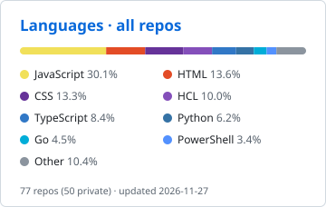

<!-- Visita Interiora Terrae Rectificando Invenies Occultum Lapidem. -->

<div align="center">


<a href="https://github.com/ryangois">
  
</a>

<p>
  <a href="https://www.linkedin.com/in/ryan-gois/"></a>
  <a href="mailto:ryangoisdev@gmail.com"></a>
  <a href="https://ryangois-portifolio.vercel.app/"></a>
  <a href="https://instagram.com/ryan.gois"></a>
</p>

📍 Rio de Janeiro, Brazil &nbsp;·&nbsp; 🌐 Português / English

</div>

---

### 👋 Hi, I'm Ryan

I'm a **Cloud Infrastructure Engineer at [TechnipFMC](https://www.technipfmc.com/)**, working on architecture, migration, FinOps and operations across **Azure and AWS** with global teams. I started shipping software as a **freelance full-stack developer at 16**, with real clients, real deadlines and code that had to work on Monday. I hold a **B.Sc. in Computer Science** (Estácio) and I'm now doing a **postgraduate program in DevOps & Cloud Architecture at FIAP**.

When I'm not in a Terraform plan, I'm somewhere between philosophy, art and science. I think good engineering needs both: logic and method, and the imagination to see what doesn't exist yet.

<div align="center">

| 🏢 **4** | 💰 **US$ 2.5M+** | 🚀 **24+** |
|:---:|:---:|:---:|
| global datacenters migrated to the cloud | saved through FinOps cycles | large-scale projects delivered |

</div>

<details>
<summary><b>🇧🇷 Leia em português</b></summary>
<br/>

Sou **Cloud Infrastructure Engineer na TechnipFMC**, trabalhando com arquitetura, migração, FinOps e operações em **Azure e AWS** junto a times globais. Comecei cedo: aos **16 anos já desenvolvia software como freelancer full stack**, com clientes reais, prazos reais e soluções que precisavam funcionar na segunda-feira.

Sou **bacharel em Ciência da Computação** pela Estácio e estou cursando a **pós-graduação em DevOps e Arquitetura Cloud na FIAP**. Entrei na TechnipFMC como estagiário em 2024 e, desde dezembro de 2025, sou engenheiro de infraestrutura cloud.

- 🏢 **4** datacenters globais migrados para a nuvem
- 💰 **US$ 2,5 mi+** economizados em ciclos de FinOps
- 🚀 **24+** projetos de grande porte entregues

**Agora:** estudando Platform Engineering (infraestrutura como produto interno), IA aplicada à operação e formas mais humanas de explicar sistemas complexos.

Fora do código, vivo entre filosofia, arte e ciência. Engenharia exige lógica e método; arte e filosofia nos convidam a imaginar o que ainda não existe. **Engenheiro de nuvem. Aprendiz de todo o resto.**

*Clareza antes da complexidade · Curiosidade antes da certeza · Sistemas devem servir às pessoas*

📬 Vamos conversar: [ryangoisdev@gmail.com](mailto:ryangoisdev@gmail.com) · [LinkedIn](https://www.linkedin.com/in/ryan-gois/)

</details>

---

### 🪐 Seven domains, one center

The ancients split the sky into seven planets, each ruling a part of life. I split my work the same way.

| | Domain | What it means in practice |
|:---:|---|---|
| ☉ | **Platform Engineering** *(the center)* | A good platform is invisible: golden paths, reusable modules, infra as an internal product |
| ♃ | **Scale, migration & FinOps** | Datacenter → cloud migrations, rightsizing, budgets: growth with the cost under control |
| ♄ | **Security & governance** | RBAC, least privilege, Azure Policy, landing zones, architecture reviews |
| ☿ | **Automation & integration** | Terraform, Bicep, GitHub Actions, Azure DevOps, PowerShell, Python |
| ♂ | **Operations & reliability** | Multicloud ops, incident response, observability, backup, Docker & Kubernetes |
| ☽ | **Data & intelligence** | Logs, metrics, SQL and AI for operations, spotting patterns before they become incidents |
| ♀ | **Design & experience** | Clear interfaces, readable docs, human ways to explain complex systems |

---

### 🧰 Toolbox

<p align="center">
  <b>Cloud & IaC</b><br/>
  <picture>
    <source media="(prefers-color-scheme: dark)" srcset="https://skillicons.dev/icons?i=azure,aws,terraform,docker,kubernetes,linux,githubactions,powershell,bash&theme=dark" />
    
  </picture>
</p>
<p align="center">
  <b>Code & data</b><br/>
  <picture>
    <source media="(prefers-color-scheme: dark)" srcset="https://skillicons.dev/icons?i=python,go,ts,js,java,c,postgres,redis,supabase&theme=dark" />
    
  </picture>
</p>
<p align="center">
  <b>Web</b><br/>
  <picture>
    <source media="(prefers-color-scheme: dark)" srcset="https://skillicons.dev/icons?i=react,nextjs,nodejs,spring,threejs,html,css,sass,figma&theme=dark" />
    
  </picture>
</p>

<p align="center">
  
  
  
  
  
  
  
</p>

---

### 🔭 Featured work

| Project | What it is | Stack |
|---|---|---|
| 🚦 **[ToggleMaster](https://github.com/ryangois/fiap-postech-tc-fase2)** | Feature-flag platform split into 5 microservices: Docker locally, Kubernetes (EKS) on AWS, provisioned with Terraform | Go · Python · EKS · SQS · DynamoDB · Redis |
| 🏛️ **[Azure Landing Zone](https://github.com/ryangois/az_landing_zone)** | Reference platform landing zone as code: management groups, subscriptions, policies, shared services | Terraform · Azure |
| ⚡ **[Serverless To-Do](https://github.com/ryangois/serverless-to-do-app)** | Event-driven, function-based backend with near-zero ops overhead | TypeScript · Serverless |
| 🛠️ **[VM SDD Update](https://github.com/ryangois/VM_SDD_update)** | Automation for repeatable VM maintenance and operational routines | PowerShell · Azure |
| 🏋️ **[Diaita Mobile](https://github.com/ryangois/diaita-mobile)** | Training, diet and body-progress app: workout plans, food diary, progress dashboards | TypeScript · React Native · Expo |
| 🔮 **[Hermetika](https://github.com/ryangois/lamen)** | Interactive hermetic encyclopedia: the 72 angels, Tree of Life, Tarot and gematria in one visual, installable app | React · Vite · Supabase · PWA |
| 🗂️ **[Role Mapper](https://github.com/ryangois/role_mapper)** | Navigable org chart showing who owns what in a team | JavaScript |
| 🍉 **[Watermelon Game](https://github.com/ryangois/watermelon-game)** | Physics-based fruit-merging game in the browser | JavaScript · Matter.js |

#### 🔒 Private builds

Most of my work lives in private repos. A few I can talk about:

| Project | What it is | Stack |
|---|---|---|
| 🎓 **Ynys Môn Portal** | Educational platform with auth, data governance, tests and Docker. Full-stack, from architecture to production | React · TypeScript · Supabase · Docker |
| 🧬 **BioQuali** | Production app on a Linux VPS with its own domain and private infra. I own deploy, server and operations | PHP · Linux · VPS |
| 🏋️ **Multi-Personal** | Multi-tenant platform for personal trainers, ready for a VPS with Coolify | Next.js · Supabase · Coolify |
| 🏛️ **Personal site** | Winged Victory of Samothrace rendered live in Three.js. CSP, a11y tests, Terraform infra and CI | Three.js · Playwright · Terraform · Azure |
| 🐕 **Scent Hound Studio** | Pipeline for animated vertical shorts about perfume: SVG rig, editor, voice timing, renderer | JavaScript · SVG |
| 🌸 **Nota de Pele** | Editorial perfume site with reviews, guides and affiliate-link management | TypeScript |

<details>
<summary><b>🧪 On the workbench</b> (not shipped yet)</summary>
<br/>

- **Multi-Cloud FinOps Command Center**: Azure + AWS costs, anomaly detection, budgets, tag coverage and rightsizing in one place.
- **Cloud Migration Factory**: inventory, readiness assessment, wave planning, cutover and traceability for datacenter migrations.
- **Secure Terraform Delivery Platform**: reusable modules, security validation, plan analysis, approvals, policy and drift detection.

</details>

---

### 🌱 Right now

- 🎓 **Studying:** Postgraduate in DevOps & Cloud Architecture @ FIAP (since May 2026)
- 🧱 **Exploring:** Platform Engineering, meaning infrastructure as an internal product with golden paths for teams
- 🤖 **Curious about:** AI for operations, with agents and automations that see incidents coming
- 💬 **Ask me about:** Azure landing zones, Terraform, cloud migration, FinOps, or Raphael's *School of Athens*

---

### 🧭 Journey

```text
2018 ──● Freelance full-stack developer at 16: web apps, APIs, integrations (until 2023)
2022 ──● B.Sc. Computer Science, Estácio (2022–2025)
2024 ──● Cloud Infrastructure Intern @ TechnipFMC: on-prem → Azure migrations, automation
2025 ──● Cloud Infrastructure Engineer @ TechnipFMC: architecture, migration, FinOps, ops on Azure & AWS
2026 ──● Postgraduate in DevOps & Cloud Architecture, FIAP
  ∞  ──○ Beyond code: art, philosophy, culture and science as one search
```

---

### 🏆 Credentials

<p>
  
  
  
  
  
  
  
</p>

---

### 📊 Activity

<div align="center">
  <picture>
    <source media="(prefers-color-scheme: dark)" srcset="./assets/languages.svg" />
    
  </picture>
  <picture>
    <source media="(prefers-color-scheme: dark)" srcset="https://streak-stats.demolab.com?user=ryangois&theme=github-dark-blue&hide_border=true&border_radius=6" />
    
  </picture>
  <br/><br/>
  <picture>
    <source media="(prefers-color-scheme: dark)" srcset="https://raw.githubusercontent.com/ryangois/ryangois/output/github-snake-dark.svg" />
    
  </picture>
</div>

---

<div align="center">

> *"I don't just want to master tools. I want to understand systems, connect ideas,<br/>and turn knowledge into something meaningful."*

**01** Clarity before complexity &nbsp;·&nbsp; **02** Curiosity before certainty &nbsp;·&nbsp; **03** Systems should serve people

Between logic and imagination. **[Let's talk →](mailto:ryangoisdev@gmail.com)**


</div>
